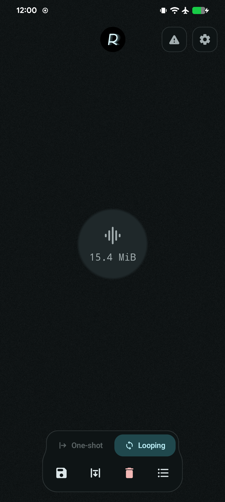
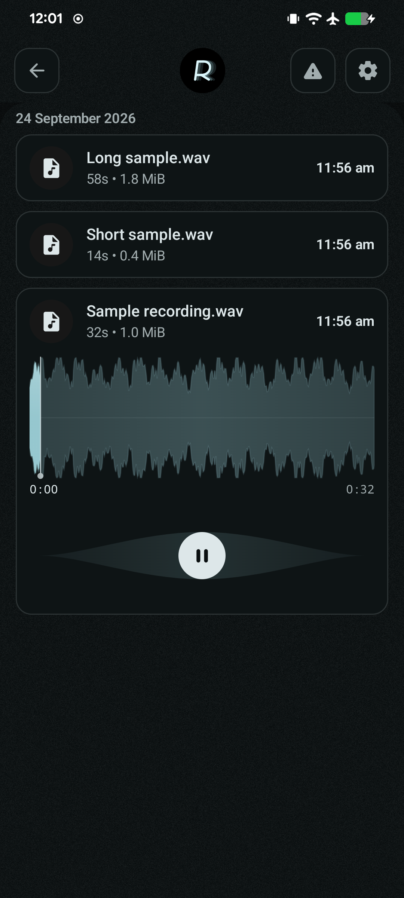
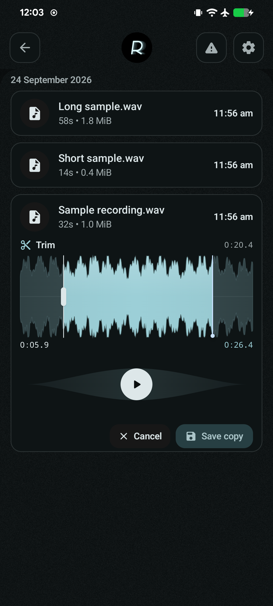
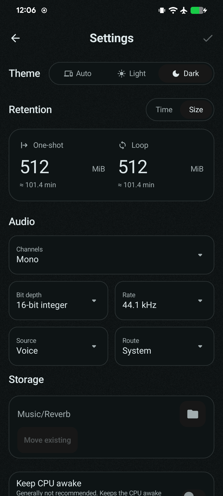

<h1>
  
  Reverb
</h1>


[](https://f-droid.org/packages/app.smallthingz.reverb/)

Rolling audio buffer recorder for Android. Keeps recent audio alive, survives restarts, and exports past audio fast.

Forked from `Echo`, now reworked and shipped as `Reverb`.

## ✨ Highlights

- Rolling buffer with disk-backed restore
- Material audio blob driven live from the recorder, with visualization work disabled when the capture UI is not visible
- Streamed WAV export without loading the whole history into memory
- In-app player, rename, delete, and move flows
- Hardware-aware sample format, rate, source, route, and channel selection

## Screenshots

<p>
  
  
  
  
</p>

*Screenshots use sample recordings.*

## 📦 App

- Package: `app.smallthingz.reverb`
- Module: `app`

## 🛠️ Build

```bash
python3 scripts/bootstrap-native-ui.py
./gradlew :app:assembleDebug
./gradlew :app:assembleRelease
```

The native UI library is a separate Git repository pinned as `native-ui`.
The bootstrap command verifies and restores it from the committed offline bundle;
it does not fetch from a network or overwrite local library changes. Use the same
step after a plain clone, in a fresh CI checkout or in a source archive. The bundled
locator uses this bootstrap flow, not `git clone --recurse-submodules` or generic
`git submodule update --init`. See [Native UI](docs/native-ui.md).
